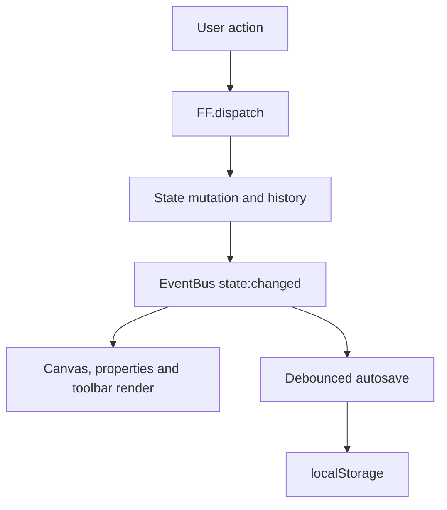

# Form Components Builder

FormForge is a browser-based form builder for composing, validating, previewing and exporting form definitions.

[](https://github.com/Aaqibhafeezkhan/Form-Components-Builder/actions/workflows/deploy.yml)

Form Components Builder runs in the browser and stores form definitions in localStorage. It has no server-side submission endpoint and does not transmit form responses.

## Try it in 60 seconds

1. Open the application.
2. Select **Templates** to open the Template Gallery.
3. Choose **Use Template** to load a starting form.
4. Select **Preview** and switch between Desktop, Tablet and Mobile.
5. Select **Export** to inspect JSON Schema, Form JSON, HTML or React JSX.

## Features

- 22 field types across Basic, Advanced and Layout groups.
- Drag-and-drop field placement and canvas reordering.
- Field properties, validation rules and conditional logic.
- Four themes: Default, Dark, Minimal and Corporate.
- Preview with device frames, local validation and test-data autofill.
- JSON Schema, Form JSON, HTML and React JSX exporters.
- Seven built-in templates and locally saved custom templates.
- Undo and redo with a 50-entry history limit.
- localStorage autosave with a versioned envelope.
- Keyboard shortcuts and screen-reader announcements.

## Accessibility

The interface includes ARIA labels and live regions, keyboard shortcuts, focus movement when opening modals, and a high-contrast toggle. These features are not a claim of WCAG conformance.

## Architecture

The application uses classic scripts that share the `window.FF` namespace. User actions dispatch to the reducer, state changes trigger rendering and a debounced localStorage save.



See [Architecture](docs/ARCHITECTURE.md) for the module map and data flow.

## Security model

| Control | Implementation | Verification |
|---|---|---|
| HTML output encoding | `src/utils/safe.js`, `FF.Safe.escapeHtml` | Reviewed, not covered by tests |
| Import key and shape checks | `src/utils/safe.js`, `FF.Safe.hasDangerousKeys`; `src/utils/validation.js`, `validateImport` | Reviewed, not covered by tests |
| Strict import limits | `src/utils/validation.js`, `validateImport` | Reviewed, not covered by tests |
| Custom CSS policy | `src/utils/safe.js`, `checkCustomCss`; `src/components/toolbar.js`, `applyCustomCss` | Reviewed, not covered by tests |
| Redirect URL validation | `src/utils/safe.js`, `isSafeRedirectUrl` | Existing unit test |

## Run locally and test

Use Node.js 18 or newer for the test runner. Serve the repository root with a static file server.

```bash
python -m http.server 8080
npm test
```

Open `http://localhost:8080`. The application loads highlight.js and qrcode.js from cdnjs and Inter from Google Fonts.

## Limitations

- Form data and saved templates remain in the current browser.
- Preview submission is local only and does not send responses to a server.
- The exported HTML renders fields only; it does not include validation rules, conditional logic, steps or themes.
- React JSX export supports a subset of field types.
- The redirect URL setting is stored and validated but is not executed.
- QR generation is limited to about 2.9 KB; use the JSON download for larger forms.
- Pathological regular expressions may still take time to evaluate.
- CDN assets require a network connection.
- Automated browser tests are not included; browser versions are not represented as a tested compatibility matrix.

## Roadmap

- Add browser end-to-end tests with Playwright.
- Add automated accessibility checks with axe-core.
- Implement redirect handling and richer standalone HTML behavior.
- Add optional submission webhook integrations.
- Add interface and template internationalization.

## Contributing

See [Contributing](CONTRIBUTING.md). Sign commits with the Developer Certificate of Origin using `git commit -s`.

## Author

[Aaqibhafeez Khan](https://github.com/Aaqibhafeezkhan)

## License

[MIT](LICENSE)
